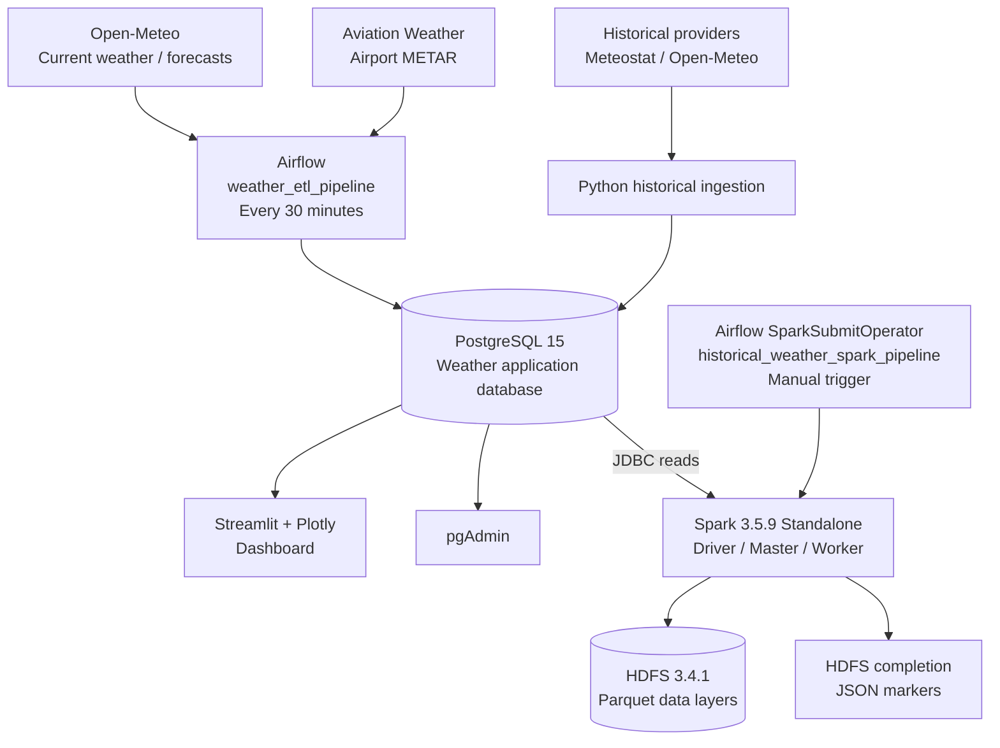
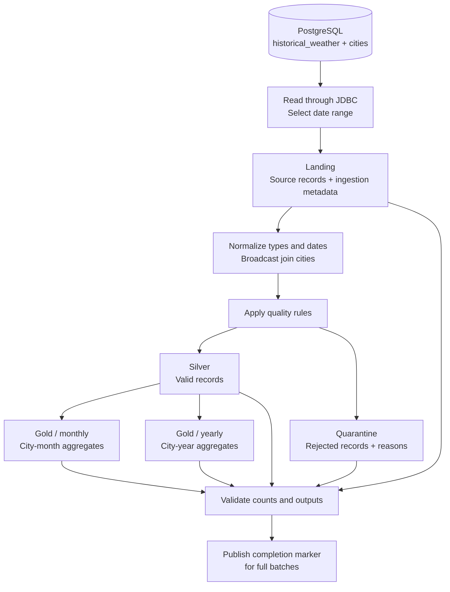
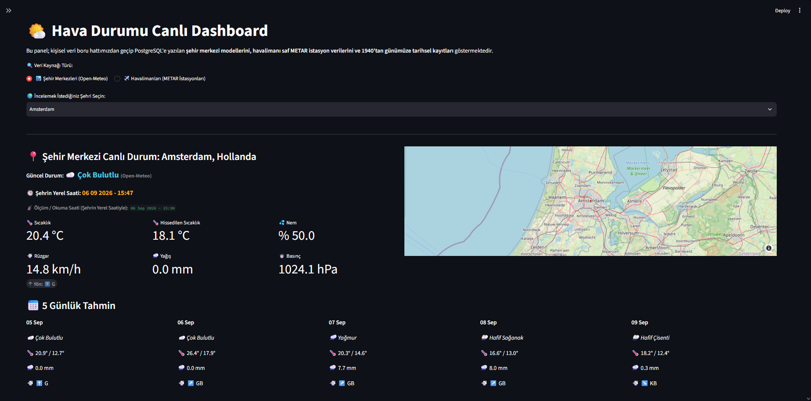
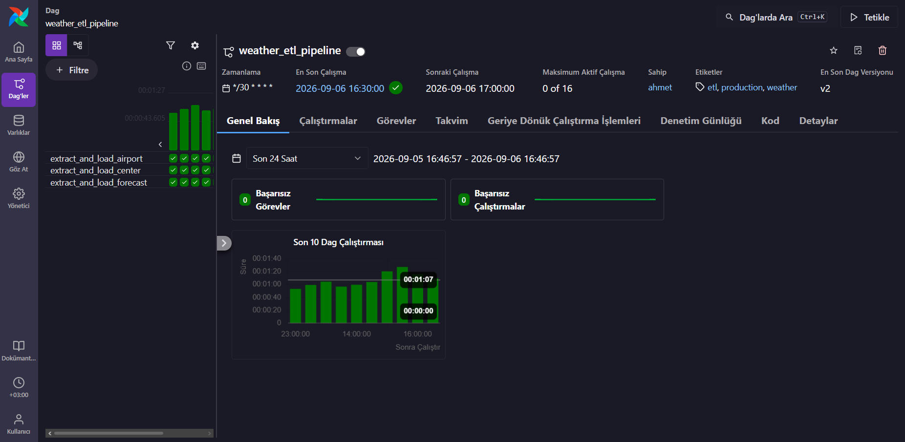

# 🌦️ Weather Data Engineering Platform

**A local end-to-end weather data platform combining automated API ingestion, PostgreSQL storage, Apache Airflow orchestration, Spark batch analytics, HDFS/Parquet data layers, and a Streamlit dashboard.**

Built as a hands-on **Data Engineering portfolio project**, this repository explores the full lifecycle of weather data: collecting observations, storing historical records, transforming them into analytical datasets, validating quality, and recovering from processing failures.

**Core stack:** Python · PostgreSQL 15 · Apache Airflow (Astro) · Apache Spark 3.5.9 / PySpark · Hadoop HDFS 3.4.1 · Parquet · Docker · Streamlit · Plotly

> **Project scope:** This is a locally deployed engineering project, not a managed cloud or production-scale service. The operational dashboard currently queries PostgreSQL; it does **not** read Spark Gold outputs directly.

## Contents

- [What the platform does](#what-the-platform-does)
- [Architecture](#architecture)
- [Data sources and database](#data-sources-and-database)
- [Airflow orchestration](#airflow-orchestration)
- [Spark historical analytics pipeline](#spark-historical-analytics-pipeline)
- [Data quality and reliability](#data-quality-and-reliability)
- [Verified execution results](#verified-execution-results)
- [Repository structure](#repository-structure)
- [Local setup](#local-setup)
- [Running and validating a historical batch](#running-and-validating-a-historical-batch)
- [Automated tests](#automated-tests)
- [Dashboard and screenshots](#dashboard-and-screenshots)
- [Engineering decisions and limitations](#engineering-decisions-and-limitations)

## What the platform does

The system has **two related but separate processing paths**:

| Path | Inputs | Processing / storage | Output |
| --- | --- | --- | --- |
| Operational weather ingestion | Open-Meteo current weather and forecasts; aviation METAR observations | Airflow Python tasks → PostgreSQL | Weather tables queried by Streamlit / Plotly |
| Historical batch analytics | Historical records already stored in PostgreSQL (`historical_weather`, `cities`) | Airflow `SparkSubmitOperator` → Spark Standalone → HDFS Parquet | Landing, Silver, Quarantine, monthly Gold and yearly Gold datasets |

A separate Python historical ingestion process can populate PostgreSQL from historical weather providers, including Meteostat and Open-Meteo, subject to source coverage and API availability.

**Highlights**

- Scheduled city weather, airport METAR, and forecast ingestion.
- PostgreSQL reference and observation tables, constraints, and conflict-aware writes.
- A Docker-based application stack and a separate Astro-managed Airflow environment.
- A modular PySpark batch ETL pipeline with a broadcast city-dimension join.
- Per-run HDFS outputs and explicit data quality quarantine records.
- Deterministic batch keys, completion manifests, validation, and retry/recovery tests.
- Interactive weather and historical-climate visualizations through Streamlit.

## Architecture



**Separation of responsibilities:** Airflow coordinates the jobs, PostgreSQL stores application data, Spark transforms historical datasets, HDFS stores batch artifacts, and Streamlit presents PostgreSQL-backed analytics. Airflow's own metadata database is separate from the application PostgreSQL database.

## Data sources and database

The application integrates:

- **Open-Meteo:** city-level weather measurements and multi-day forecasts.
- **Aviation Weather / METAR:** airport-based observations identified by ICAO codes.
- **Meteostat and Open-Meteo historical data:** historical daily weather observations where available.

The reference dataset currently covers **27 cities and 27 airports**. The main application tables include:

```text
cities                      airports
center_hourly_weather_data  airport_hourly_weather_data
daily_forecast_data         historical_weather
```

The database is initialized using [`database/schema.sql`](database/schema.sql) and [`database/seed.sql`](database/seed.sql) when PostgreSQL starts with a **fresh** data volume. Existing persistent volumes are not automatically reinitialized.

The operational ingestion code uses unique constraints and `ON CONFLICT` handling to avoid duplicate current observations and to update forecast records when appropriate.

## Airflow orchestration

| DAG | Schedule | Purpose | Retry behavior |
| --- | --- | --- | --- |
| `weather_etl_pipeline` | `*/30 * * * *` | Fetch and load city weather, airport observations, then forecasts | 2 retries; 3-minute delay |
| `historical_weather_spark_pipeline` | Manual (`schedule=None`) | Submit a parameterized Spark historical batch | 1 retry; 30-second delay |

The operational DAG starts city-center and airport tasks independently and runs forecast ingestion after both upstream tasks complete.

The historical DAG uses `SparkSubmitOperator`, the `spark_default` Airflow connection, and Spark **client deployment mode**. Its driver runs in the Airflow scheduler container and submits work to the Spark Standalone master at `spark://spark-master:7077`.

For a historical batch, the DAG accepts `start_date` and `end_date` in its trigger configuration. Two **test-only** parameters, `test_fail_after_silver` and `test_fail_first_attempt`, default to `false` and were used to verify failure propagation and automatic retry behavior.

Source: [`airflow/dags/historical_weather_spark_dag.py`](airflow/dags/historical_weather_spark_dag.py).

## Spark historical analytics pipeline



The pipeline is organized as small modules under [`spark_jobs/weather_pipeline/`](spark_jobs/weather_pipeline):

| Module | Responsibility |
| --- | --- |
| `main.py` | CLI parameters, Spark session, run orchestration and logging |
| `config.py` | Spark / JDBC / HDFS environment configuration |
| `extract.py` | JDBC reads of historical observations and city metadata |
| `transform.py` | Normalization, enrichment and monthly/yearly aggregates |
| `quality.py` | Quality flags and valid/quarantine split |
| `validation.py` | Landing/Silver/Quarantine row-count reconciliation |
| `load.py` | Parquet writes |
| `batch.py` | Deterministic logical batch identity |
| `completion.py` | HDFS completion manifest creation and verification |

**Output layout (example):**

```text
hdfs://namenode:8020/weather/lab/final_sprint/
├── runs/
│   └── <run_id>/
│       ├── landing/
│       ├── silver/
│       ├── quarantine/
│       └── gold/
│           ├── monthly/
│           └── yearly/
└── completed/
    └── historical_full_YYYYMMDD_YYYYMMDD.json
```

All five data outputs are stored as **Parquet**. Landing retains ingestion metadata, Silver contains valid normalized records, Quarantine retains rejected records and their quality reasons, and Gold contains per-city monthly and yearly aggregates such as mean temperature and total precipitation.

## Data quality and reliability

### Quality rules

The Silver/Quarantine split includes checks for:

- Missing city mapping or observation date.
- Future observation dates.
- Negative precipitation or snow values.
- An invalid minimum/maximum temperature order.
- Average temperature outside a populated min/max interval.

For each processed batch, row-count reconciliation enforces:

```text
Landing rows = Silver rows + Quarantine rows
```

The current policy also rejects empty Landing or Silver outputs.

### Idempotency and recovery

- **`batch_key`** identifies a logical work unit using its mode and date range (for example, `historical_full_19400501_19400531`).
- **`run_id`** is a new UUID for each physical execution attempt. Outputs are isolated under `runs/<run_id>`.
- A successful **full** batch publishes an HDFS JSON manifest containing its batch key, successful run ID, status, and counts.
- On repeated execution, a full batch with an existing valid completion marker is **skipped** rather than unnecessarily reprocessed.
- Completion validation checks metadata, count reconciliation and the presence of Spark `_SUCCESS` indicators for all five output directories.
- Completion metadata is written through a temporary file followed by a rename operation.

**Important boundaries:** This does not implement a distributed lock or concurrent-writer-safe publication. A marker and `_SUCCESS` files do not prove full Parquet content integrity. Batch identity currently does not incorporate a source-data version; changing source data for an already completed date range does not automatically cause recomputation. `sample` mode is deliberately excluded from completion-marker-based skipping.

## Verified execution results

The following are **observed local test runs**, not cluster performance benchmarks:

| Scenario | Landing | Silver | Quarantine | Monthly Gold | Yearly Gold | Outcome |
| --- | ---: | ---: | ---: | ---: | ---: | --- |
| March 1940 (full) | 496 | 492 | 4 | 16 | 16 | End-to-end success |
| April 1940 (retry recovery) | 480 | 480 | 0 | 16 | 16 | First attempt deliberately failed; second succeeded |
| May 1940 (full) | 496 | 495 | 1 | 16 | 16 | End-to-end success; completion manifest written |

The April retry test deliberately raised `INJECTED_FAILURE_AFTER_SILVER` on the first attempt. Airflow re-ran the Spark job, produced a new run ID, completed Gold processing, and published a success marker. May's reported run took **33.55 seconds** on the local test environment; this number is not a generalized Spark throughput claim.

Example completion marker:

```json
{
  "batch_key": "historical_full_19400501_19400531",
  "counts": {
    "landing": 496,
    "monthly": 16,
    "quarantine": 1,
    "silver": 495,
    "yearly": 16
  },
  "run_id": "46a3b236-fa7e-400c-9732-f267457c1225",
  "status": "SUCCESS"
}
```

## Repository structure

```text
Weather-Data-Engineering-Platform/
├── airflow/
│   ├── dags/
│   │   ├── weather_pipeline_dag.py
│   │   ├── historical_weather_spark_dag.py
│   │   └── src/                  # API ingestion helpers
│   ├── Dockerfile              # Astro image with Spark / Java / Python 3.10
│   ├── docker-compose.override.yml
│   ├── .env.example
│   └── README.md
├── infra/
│   └── spark-hdfs/
│       ├── Dockerfile          # Spark client image with PostgreSQL JDBC jar
│       ├── docker-compose.hdfs.yml
│       └── config/             # Hadoop XML configurations
├── spark_jobs/
│   └── weather_pipeline/       # Modular PySpark historical ETL
├── tests/                      # Python unit tests
├── database/
│   ├── schema.sql
│   └── seed.sql
├── history/                    # Source-to-PostgreSQL historical ingestion
├── docs/images/               # Dashboard / Airflow screenshots
├── app.py                     # Streamlit application
├── docker-compose.yml         # PostgreSQL, pgAdmin, Streamlit
├── .env.example
└── README.md
```

## Local setup

### Prerequisites

- Git, Docker Desktop / Docker Compose, and the **Astronomer Astro CLI**.
- A Docker environment with enough resources for PostgreSQL, Airflow, Spark and Hadoop.
- A configured **Spark Standalone master and worker** on the shared `weather_data_net` network; the master must be discoverable as `spark-master:7077`.
- The weather PostgreSQL application database populated with historical data for meaningful historical-batch tests. Database schema/seed scripts create reference structures, **not the full historical observation dataset**.

> **Reproducibility note:** This repository contains a Compose file for HDFS and a Spark *client/test* container, but it does not yet provide a verified, self-contained deployment manifest for the separate Spark Standalone master/worker services. Accordingly, cloning the repository alone is **not** a one-command recreation of the complete historical analytics environment. The instructions below describe the working local arrangement and its prerequisites.

### 1. Clone and configure the application

```powershell
git clone https://github.com/Avdatek5003/Weather-Data-Engineering-Platform.git
cd Weather-Data-Engineering-Platform
# Until the Spark feature branch is merged into the default branch:
git switch feature/spark-analytics-layer
Copy-Item .env.example .env
```

Fill in the actual local credentials in `.env`; never commit this file. A separate `airflow/.env` is needed for the Astro environment (see its [template](airflow/.env.example)).

### 2. Start PostgreSQL, pgAdmin and Streamlit

```powershell
docker compose up -d --build
docker compose ps
```

Default published local ports from the root Compose file:

| Component | URL |
| --- | --- |
| Streamlit | `http://localhost:8501` |
| pgAdmin | `http://localhost:5050` |
| PostgreSQL | `localhost:5432` |

### 3. Prepare the Spark/HDFS network and client image

The HDFS Compose file expects an **external** Docker network. Create `weather_data_net` once if it does not already exist:

```powershell
docker network create weather_data_net
```

Build the local Spark client image **before** building/starting Astro, because `airflow/Dockerfile` copies its Spark installation from the image tagged `spark-hdfs-spark:latest`:

```powershell
docker build -t spark-hdfs-spark:latest .\infra\spark-hdfs
```

Configure `WEATHER_DB_USER`, `WEATHER_DB_PASSWORD`, and `WEATHER_JDBC_URL` securely in the environment used by the HDFS Compose file, then start its NameNode, DataNode and Spark client/test container:

```powershell
docker compose -f .\infra\spark-hdfs\docker-compose.hdfs.yml up -d --build
```

This Compose file **does not** start the separate Spark Standalone master or worker. Make sure those services are present and reachable on `weather_data_net` before submitting a historical batch. The Hadoop NameNode UI uses `http://localhost:9870` in the current Compose configuration.

The Spark driver also requires write permissions for its per-run and completion directories under `/weather/lab/final_sprint` in HDFS. Set appropriate ownership/permissions for the user running the Spark driver in your local installation.

### 4. Configure and start Airflow (Astro)

```powershell
Copy-Item .\airflow\.env.example .\airflow\.env
$env:WEATHER_PROJECT_ROOT = (Resolve-Path .).Path.Replace('\', '/')
cd airflow
astro dev start
```

Fill in `airflow/.env` with the actual PostgreSQL host, username and password **before** starting Astro. The current Docker Compose override uses `WEATHER_PROJECT_ROOT` for the mounted Spark job and Hadoop XML paths; set it in the shell that launches Astro.

The historical Spark DAG requires an Airflow connection named **`spark_default`** pointing to the Spark Standalone master at `spark://spark-master:7077`, plus the shared Docker network, a readable PostgreSQL JDBC JAR and matching Python executables in the driver and executors.

- Airflow UI: `http://localhost:8080` (subject to local Astro port settings).
- The Astro Dockerfile installs Spark 3.5.9 and a separate Python 3.10 interpreter for the Spark driver; the Airflow runtime retains its own Python environment.
- `airflow/docker-compose.override.yml` is an **override**, not a standalone Compose project. Do not validate or launch it on its own without its Astro-generated base Compose configuration.

For detailed Airflow ingestion notes, see [`airflow/README.md`](airflow/README.md). That subdirectory guide also needs an update to describe the Spark DAG before the final release.

## Running and validating a historical batch

From the Airflow UI, trigger **`historical_weather_spark_pipeline`** with this example configuration:

```json
{
  "start_date": "1940-06-01",
  "end_date": "1940-06-30",
  "test_fail_after_silver": false,
  "test_fail_first_attempt": false
}
```

Use a date range with data already present in PostgreSQL. If a valid completion manifest already exists for that range, the job will skip instead of rewriting its outputs.

Expected successful log indicators include:

```text
LANDING_ROWS=...
SILVER_ROWS=... QUARANTINE_ROWS=...
COMPLETION_MARKER_CREATED ...
END-TO-END PIPELINE: PASSED
```

Inspect HDFS results with the running NameNode container:

```powershell
docker exec weather_hdfs_namenode hdfs dfs -ls /weather/lab/final_sprint/runs
docker exec weather_hdfs_namenode hdfs dfs -ls /weather/lab/final_sprint/completed
docker exec weather_hdfs_namenode hdfs dfs -cat /weather/lab/final_sprint/completed/historical_full_19400501_19400531.json
```

To test the already completed May batch a second time, trigger the same dates with both failure-test flags set to `false` and look for `BATCH_ALREADY_COMPLETED_AND_VALIDATED` and `PIPELINE SKIPPED` in the task log.

## Automated tests

Run the pure-Python unit tests from the repository root:

```powershell
$env:PYTHONPATH = (Resolve-Path .\spark_jobs).Path
python -m unittest discover -s tests -p "test_*.py" -v
python -m py_compile .\spark_jobs\weather_pipeline\main.py
```

The current suite has **8 passing tests** covering deterministic batch keys and row-count validation. Real Spark/HDFS integration and Airflow retry behavior were also tested manually; they are **not** represented by these eight unit tests.

## Dashboard and screenshots

The Streamlit dashboard reads **PostgreSQL** and provides interactive visualizations for current observations, airport conditions, forecasts and historical climate trends.

**Dashboard overview**



**Airflow ingestion DAG**



Additional final-release evidence worth capturing: Spark Master/Worker UI, an Airflow successful historical batch, HDFS Landing/Silver/Gold directories, and a completion-marker validation log. Only add screenshot links after the actual image files have been committed.

## Engineering decisions and limitations

| Decision / constraint | Rationale or current state |
| --- | --- |
| Separate operational and historical paths | API ingestion and batch analytics have different scheduling and compute needs. |
| PostgreSQL for the app, HDFS Parquet for batch artifacts | Keeps transactional/application data and analytical batch outputs distinct. |
| Broadcast city dimension | Avoids a large shuffle for a relatively small lookup table. |
| Quarantine instead of dropping invalid data | Preserves problematic observations and their failure reasons for inspection. |
| Run-scoped UUID output directories | Prevents a failed attempt from overwriting earlier attempts. |
| Completion marker only after success | Supports verified skip behavior for full batches. |
| Manual date-range DAG | Historical batch processing is explicitly triggered; it is not a continuously scheduled Spark streaming job. |
| Spark performance | Local month-sized tests demonstrate execution correctness, not large-scale benchmarking or tuning. |
| Concurrency and changes to historical sources | No distributed per-batch lock or automatic source-version-based reprocessing yet. |
| Reproducibility | The Spark master/worker environment must be supplied and documented more fully for clean-room installation. |
| Dashboard integration | The existing dashboard queries PostgreSQL rather than Spark Gold Parquet. |
| Deployment | Local Docker/Astro/HDFS system; no claim of production cloud deployment or Kafka streaming. |

### Engineering skills demonstrated

**Python ETL · Airflow DAGs · PySpark DataFrames · Spark Standalone · PostgreSQL JDBC · Docker networking · HDFS · Parquet · Medallion-style processing · Data quality checks · Idempotency · Retry/recovery · Testing · Streamlit analytics**

---

**Project maintained by [Avdatek5003](https://github.com/Avdatek5003).**
